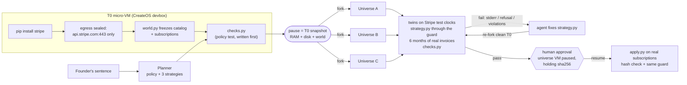

# Rehearsal

**Rehearse a Stripe pricing change in forked micro-VMs before it touches a real customer.**

A price change is the riskiest deploy a SaaS company makes: every customer's bill changes at once, and you find out what broke (surprise proration charges, grandfathered customers billed the new price, annual plans touched by accident, failed invoices) only after the first billing cycle.

Rehearsal takes one sentence from a founder, for example:

> *Raise Pro monthly from $20 to $29. Everyone already on Pro keeps paying $20 for their next 3 renewals, then moves to $29. Don't touch annual plans, Starter or Team.*

It then writes a policy test from that sentence and three different migration strategies, and runs each strategy for six billed months on Stripe's own billing engine. Each strategy runs in its own fork of one paused micro-VM. Failed attempts go back to the agent until the test passes. Nothing touches a real subscription until a human approves one universe, and the apply step refuses to run unless the code is byte-for-byte what was approved.

**Live:** https://production-rehearsal-app.tyzo.nodeops.app · **Recorded run:** [/?replay=c0763a07](https://production-rehearsal-app.tyzo.nodeops.app/?replay=c0763a07)

## What a run looks like

Two recorded runs ship in `replays/` and play back on the deployed app. Both ran against a seeded test-mode account: 12 subscriptions across Starter, Pro monthly, Pro annual and per-seat Team, including one trial and one cancellation at period end.

**`c0763a07`**: *"Move Pro monthly from $20 to $29 as fast as we can without breaking promises: no existing Pro customer ever pays more than $29 a month, nobody gets a mid-cycle charge over $10, and annual, Starter and Team plans stay exactly as they are."*
- Three universes: swap at renewal, scheduled price switch, immediate prorated swap.
- The scheduled switch crashed on its first attempt: Stripe returned `Received unknown parameter: phases[iterations]`, a parameter the current API version removed. The agent replaced it with `duration` and passed in a fresh fork.
- All three passed the policy test. Over six simulated months each collected $2,168 against $1,898 for the status quo, with zero proration lines and zero failed invoices.
- Tamper test on universe B: refused inside the VM (`strategy.py changed after approval`).
- Universe A applied: 5 Pro monthly subscriptions moved, 7 left untouched as the policy required, 5 Stripe calls, 0 refused by the guard.

**`a54b9134`**: *"Raise Pro monthly from $20 to $29. Everyone already on Pro monthly keeps paying $20 for their next 3 renewals, then moves to $29. Do not touch annual plans, Starter or Team."*
- Two universes crashed on the same removed `iterations` parameter and fixed it. The coupon universe ran cleanly but broke the policy in 15 places and was rewritten.
- The approved universe put 5 subscriptions on schedules: 3 renewals at $20, then $29. The cancelling customer was left alone. 11 Stripe calls, 0 refused.

## How it works



1. **Freeze.** A CreateOS `devbox:1` micro-VM installs `stripe-python`, then its egress is set to `api.stripe.com:443` only. The server probes the seal from inside the VM (Stripe answers; `example.com`, PyPI and `api.github.com` time out) and refuses to continue if the seal didn't take. `world.py` reads the catalog and every live subscription into `world.json`.
2. **Write the test first.** The planner turns the founder's sentence into a precise, checkable policy and three strategies that differ in mechanism (for example a subscription schedule, a swap at renewal, a coupon-based soft landing). A second call writes `checks.py` from the policy before any strategy exists. The test is loaded and smoke-tested inside the VM.
3. **Snapshot.** The T0 VM is paused. RAM, disk, the frozen world and the policy test become the snapshot every universe starts from.
4. **Fork.** Each strategy gets its own fork of T0, with the same egress rule and a public preview URL. Inside the fork, `universe.py`:
   - creates a twin of every real subscription on Stripe test clocks, with the same price, quantity, trial and renewal date;
   - runs the agent's `strategy.py` against the twins through the capability guard;
   - advances the test clocks month by month, so Stripe generates the renewals, prorations and payments;
   - collects every invoice and line and runs `checks.py` over the timeline;
   - serves its own report on port 8080.
5. **Fix.** Any failure (a crash, a guard refusal or a policy violation) goes back to the agent with the exact output. The next attempt runs in a fresh fork of T0, never in the dirty one.
6. **Approve.** You pick a universe whose test passed. Its VM is paused, so the verified `strategy.py` is held as tested rather than regenerated. Approving resumes that VM and runs `apply.py` against the real subscriptions.

## The safety model

| Layer | Where | What it stops |
|---|---|---|
| Egress seal | CreateOS, enforced on the host outside the VM | Anything but `api.stripe.com:443`. Data can't leave, packages can't be fetched mid-run. |
| Static check | `sandbox/guard.py`, before code runs | `requests`/`urllib`/`socket`/`subprocess`, `os.environ`, `open`, `eval`/`exec` in agent code |
| Capability guard | `sandbox/guard.py`, wraps every stripe-python request | Writes to any subscription that isn't on the allowlist, deletes, refunds, payouts, customer edits, schedules from other subscriptions. Catalog objects created in a rehearsal are tagged so they never enter the real world. |
| Policy test | `checks.py`, written from the founder's words before any strategy | A strategy that runs but bills someone the wrong amount |
| Approval gate | control plane + `sandbox/apply.py` | Approving a universe that didn't pass; applying code whose sha256 differs from the approved one (try the **Tamper test** button) |

The same guard runs in the rehearsal (allowlist = twin subscriptions) and in the real apply (allowlist = the approved real subscriptions), so a strategy can't behave one way when rehearsed and another way in production. Every refusal is recorded and shown on the page.

## CreateOS Sandbox features used

- **pause**: the T0 snapshot, and later the approval hold (the approved universe waits paused with its exact code).
- **fork**: one fork per universe and per attempt, always from the clean T0 snapshot, each with its own egress rule.
- **egress control**: deps installed with PyPI + Stripe open, then sealed live to Stripe only, and the seal is probed from inside the VM.
- **live URL**: every universe serves its own report from its own VM (`previewUrl(8080)`).
- **resume**: approval resumes the paused universe VM and applies from inside it.

## Stripe Projects

The stack is provisioned with Stripe Projects from the command line:

```sh
stripe projects init rehearsal
stripe projects add createos/free          # CreateOS plan, billed through Stripe
stripe projects add createos/project       # CreateOS project + API key → .env
stripe projects add turso/starter          # Turso plan
stripe projects env --pull                 # credentials into .env
# more sandbox concurrency for parallel universes:
stripe projects update createos-plan --service beginner-monthly
```

## Run it

Requirements: Node 20+, a CreateOS API key, a Stripe **test-mode** secret key, and a chat-completions compatible LLM endpoint.

```sh
npm install
cp .env.example .env            # or: stripe projects env --pull
STRIPE_SECRET_KEY=sk_test_... python scripts/seed.py   # optional: seed a demo SaaS billing world
npm run build && npm start      # http://localhost:8787
```

| Variable | Purpose |
|---|---|
| `CREATEOS_SANDBOX_API_KEY` | CreateOS Sandbox API key (`CREATEOS_PROJECT_API_KEY` from Stripe Projects works too) |
| `CREATEOS_SANDBOX_BASE_URL` | Sandbox API region, default `https://api-eu.sb.createos.sh` |
| `STRIPE_SECRET_KEY` | Stripe test-mode key. It is passed only into the sandboxes. |
| `LLM_BASE_URL`, `LLM_API_KEY`, `LLM_MODEL` | Any chat-completions compatible endpoint (base URL defaults to Venice) |
| `UNIVERSES`, `SIM_MONTHS`, `MAX_ATTEMPTS`, `PARALLEL_UNIVERSES` | Defaults 3 / 6 / 3 / 3 |

Tests (11 guard tests: refused writes to other subscriptions, refunds, payouts, customer edits, deletes, foreign schedules, plus the static check):

```sh
STRIPE_SECRET_KEY=sk_test_... python -m pytest sandbox/test_guard.py -q
```

## Layout

```
server/src/rehearsal.ts   orchestration: T0, seal, freeze, plan, test, pause, fork, fix loop, approval, apply
server/src/sandbox.ts     CreateOS Sandbox SDK helpers (create, stream, egress probe)
server/src/prompts.ts     planner / policy-test / strategy / fix prompts and the code contract
sandbox/world.py          freezes the billing world at T0
sandbox/universe.py       twins on test clocks → strategy → months of billing → checks → report
sandbox/guard.py          static check + capability guard around stripe-python
sandbox/apply.py          hash-checked, guarded apply to real subscriptions
sandbox/page.html         the report each universe serves on its live URL
web/                      the control-plane UI
```

## Honest limits

- **Test mode only.** The seed script and the server refuse live keys; apply runs against test-mode subscriptions.
- **Twins approximate customers.** They copy price, quantity, trial and renewal date. They don't copy payment history, tax settings, existing discounts or schedules.
- **The guard covers what a pricing migration needs**: prices, products, coupons, subscription and item updates, schedules created from allowed subscriptions, invoice previews. A strategy that needs any other endpoint is refused, not silently allowed.
- **Months are calendar buckets from T0.** The status-quo line is computed from today's prices and renewal dates rather than simulated.
- **One plan's worth of concurrency.** Universes fork in parallel up to `PARALLEL_UNIVERSES`; on a plan with fewer sandbox slots they queue.
- **Stripe Projects `stripe/sandbox` returned HTTP 500** while this was built, so the Stripe test key is set directly in `.env`.

## License

MIT
